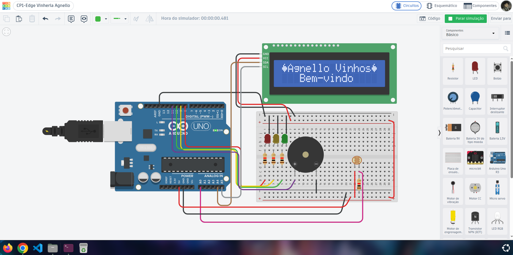

# CP1 – Vinheria Agnello: Monitoramento de Luminosidade

Checkpoint 01 da disciplina **Edge Computing & Computer Systems** – Engenharia de Software, FIAP.

## Grupo: Digital Nomads

- Anne Bortoli de Oliveira – RM574750
- Débora Cristina Gonçalves da Silva – RM575926
- Gabriel Almeida – RM575525
- Pedro Paulo Coutinho – RM575957
- Vanessa Santos Martins de Lima Nascimento – RM576450

## Descrição do projeto

A Vinheria Agnello precisa monitorar o ambiente onde os vinhos ficam armazenados, já que
a luminosidade excessiva altera os compostos do vinho e prejudica sua qualidade.

Este projeto é a primeira etapa de um sistema de monitoramento feito com Arduino: ele mede
a luminosidade do ambiente com um sensor LDR e sinaliza se as condições estão adequadas. O circuito e seu código são construídos de forma que seja facilitada a análise das circunstâncias do ambiente por parte de um operador leigo sem quaisquer conhecimentos de programação. Além disso, o projeto usa componentes simples e acessíveis, o que torna sua implementação física viável.

### Como funciona

- O LDR é ligado à porta analógica A0. O ADC do Arduino converte a tensão do
  sensor em um valor de 0 a 1023.
- Como o valor bruto (0 a 1023) não é intuitivo para o operador, a função `map()`
  converte essa leitura para uma escala de 0% a 100%, exibida no LCD.
- Conforme a luminosidade, o sistema sinaliza:

| Nível | Faixa | Sinalização |
|---|---|---|
| 🟢 OK | 0% a 30% | LED verde |
| 🟡 Alerta | 31% a 60% | LED amarelo + buzzer |
| 🔴 Crítico | acima de 60% | LED vermelho + buzzer |

- Ao ligar, o display LCD exibe o logo da empresa (uma uva desenhada com caractere
  personalizado) e a mensagem "Agnello Vinhos – Bem-vindo".

## Dependências

### Componentes

- 1x Arduino Uno R3
- 1x Protoboard
- 1x LDR (fotorresistor) + 1x resistor de 1 kΩ
- 3x LEDs (verde, amarelo e vermelho) + 3x resistores de 1 kΩ
- 1x Buzzer
- 1x Display LCD 16x2 com módulo I2C
- Jumpers

### Bibliotecas

- `Adafruit_LiquidCrystal` – controle do display LCD via I2C

## ▶️ Como reproduzir

### Para visualizar a simulação no Tinkercad:

1. Acesse o projeto: https://www.tinkercad.com/things/aIqYFCd7et2-cp1-edge-vinheria-agnello 
2. Clique em "Iniciar simulação";
3. Observe a mensagem de boas-vindas no LCD e a inicialização dos dados acerca da luminosidade;
4. Clique no LDR (componente em formato de "bolinha" laranja com linha sinuosa dentro) e mova o controle deslizante para variar a luminosidade;
5. Veja os LEDs e o buzzer reagindo a cada faixa.

### Replicando o projeto fisicamente:

1. Monte o circuito conforme a imagem do projeto (`imagens/circuito.png`);
2. Abra `src/vinheria_agnello.ino` na Arduino IDE;
3. Instale a biblioteca "Adafruit LiquidCrystal" pelo Gerenciador de Bibliotecas;
4. Envie o código para a placa.

## 🖼️ Circuito

## Vídeo do nosso projeto

[Assista ao vídeo no YouTube](https://youtu.be/6dJ79bdWtkl)

