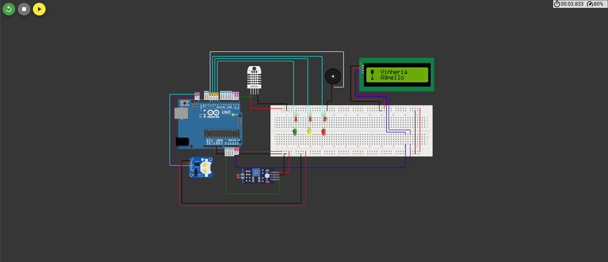
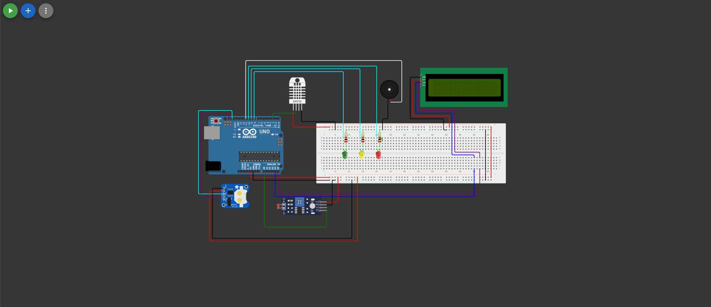

# CP2 – Vinheria Agnello: Monitoramento de Temperatura, Umidade e Luminosidade

Checkpoint 02 da disciplina **Edge Computing & Computer Systems** – Engenharia de Software, FIAP.

## Grupo: Digital Nomads

- Anne Bortoli de Oliveira – RM574750 | [@ANNEBORTOLI](https://github.com/ANNEBORTOLI)
- Débora Cristina Gonçalves da Silva – RM575926 | [@Deboracgs](https://github.com/Deboracgs)
- Gabriel Almeida – RM575525 | [@Gabriel-W-almeida](https://github.com/Gabriel-W-almeida)
- Pedro Paulo Coutinho – RM575957 | [@ppcoutinho](https://github.com/ppcoutinho)
- Vanessa Santos Martins de Lima Nascimento – RM576450 | [@Nayayaa](https://github.com/Nayayaa)

## Descrição do projeto

A Vinheria Agnello precisa garantir que os vinhos sejam armazenados em condições adequadas.
Além da luminosidade, a temperatura e a umidade influenciam diretamente a qualidade do vinho:
o calor excessivo e variações bruscas de temperatura geram aromas indesejados, a umidade baixa
resseca a rolha (permitindo a oxidação) e a umidade alta danifica rótulos e favorece fungos.

Este projeto é a segunda etapa do sistema de monitoramento. Seguindo a proposta do CP2, que
simula um retorno dos proprietários após a apresentação da primeira fase, passamos a acompanhar
também a temperatura e a umidade, exibir todos os valores em um display e emitir alertas quando
qualquer uma das grandezas estiver em nível crítico. O sistema continua pensado para um operador
leigo: as informações aparecem no LCD em mensagens simples, como "OK" ou "ALTA", e os alertas
são visuais e sonoros.

### O que mudou em relação ao CP1

- Leitura de **temperatura e umidade** com o sensor DHT22 (no Wokwi, equivalente ao DHT11 com maior precisão);
- Exibição de **temperatura, umidade e luminosidade** no display LCD 16x2 I2C;
- **Alertas com LEDs e buzzer** estendidos para temperatura e umidade;
- **RTC (Real Time Clock)** DS1307 para exibir o horário e registrar a hora das ocorrências;
- **EEPROM** para armazenar os logs e as configurações (fuso UTC e unidade de temperatura);
- **Média das leituras** de todos os sensores em intervalos de 10 segundos;
- **Logo da empresa com animação gráfica** no LCD ao iniciar;
- Migração da simulação do Tinkercad para o **Wokwi**, que possui o sensor DHT.

### Como funciona

- O LDR continua ligado à porta analógica A0. A função `map()` calibra a leitura bruta
  usando os valores medidos nos testes e a converte para uma escala de 0% a 100%.
- O DHT22 fornece a temperatura (°C) e a umidade relativa (%).
- O sistema faz uma leitura por segundo e, a cada 10 leituras válidas, calcula a **média** de
  cada grandeza. Os alertas usam essas médias, o que evita disparos causados por picos momentâneos.
- O LCD alterna a cada 3 segundos entre três telas (temperatura, umidade e luminosidade),
  mostrando o valor médio e o status (`OK`, `ATENCAO`, `BAIXA`, `ALTA` ou `MEIA LUZ`).
  O horário do RTC fica sempre visível no canto superior direito.
- A temperatura pode ser exibida em Celsius ou Fahrenheit, conforme a unidade salva nas
  configurações.
- Em situações críticas, o sistema grava na EEPROM um log com a hora (convertida para UTC),
  o minuto e as médias de temperatura, umidade e luminosidade. O log também aparece no
  Monitor Serial.
- Ao ligar, o display exibe o logo animado: uma taça que se enche de vinho em três etapas
  (vazia, pela metade e cheia), seguida do nome "Vinheria Agnello".

#### Faixas monitoradas

| Grandeza | 🔴 Crítico (baixo) | 🟡 Atenção | 🟢 Ideal | 🟡 Atenção | 🔴 Crítico (alto) |
|---|---|---|---|---|---|
| Temperatura | abaixo de 10 °C | 10 °C a 12 °C | 12 °C a 14 °C | 14 °C a 16 °C | acima de 16 °C |
| Umidade | abaixo de 60% | 60% a 65% | 65% a 75% | 75% a 80% | acima de 80% |
| Luminosidade | – | – | 0% a 30% | 31% a 60% | acima de 60% |

As faixas de temperatura foram definidas a partir do ideal de 13 °C, tolerando a variação
máxima de 3 °C recomendada. As de umidade partem do ideal de 70%, dentro da faixa aceitável
de 60% a 80%.

#### Sinalização

| Nível | Sinalização |
|---|---|
| 🟢 OK | LED verde |
| 🟡 Atenção | LED amarelo |
| 🔴 Crítico | LED vermelho + buzzer (1 s) + registro na EEPROM |

## Dependências

### Componentes

- 1x Arduino Uno R3
- 1x Protoboard
- 1x Sensor DHT22 (simula o DHT11)
- 1x Módulo fotorresistor (LDR), com resistor embutido
- 3x LEDs (verde, amarelo e vermelho) + 3x resistores de 200 Ω
- 1x Buzzer
- 1x Display LCD 16x2 (LCD1602) com interface I2C
- 1x Módulo RTC DS1307
- Jumpers

### Bibliotecas

- `LiquidCrystal I2C` – controle do display LCD via I2C
- `DHT sensor library` (Adafruit) – leitura do DHT22
- `RTClib` (Adafruit) – leitura do relógio de tempo real
- `Wire` e `EEPROM` – nativas da Arduino IDE

### Ligações

| Componente | Pino do Arduino |
|---|---|
| DHT22 (dados) | D2 |
| LDR | A0 |
| LED verde | D8 |
| LED amarelo | D9 |
| LED vermelho | D10 |
| Buzzer | D11 |
| LCD I2C (endereço 0x27) e RTC DS1307 | SDA (A4) / SCL (A5), mesmo barramento I2C |

## Como reproduzir

### Para visualizar a simulação no Wokwi:

1. Acesse o projeto: https://wokwi.com/projects/478235369877954561
2. Clique no botão verde ▶ para iniciar a simulação;
3. Observe a animação da taça enchendo no LCD e, em seguida, as telas com os valores medidos;
4. Clique no sensor DHT22 e altere a temperatura e a umidade nos controles deslizantes;
5. Clique no LDR e varie a luminosidade;
6. Aguarde até 10 segundos (tempo do cálculo da média) e veja as mensagens do LCD, os LEDs e o buzzer reagindo a cada faixa;
7. Abra o Monitor Serial para acompanhar os logs gravados em situações críticas.

### Replicando o projeto fisicamente:

1. Monte o circuito conforme as imagens do projeto (pasta `imagens/`) e a tabela de ligações;
2. Abra `src/vinheria_agnello_cp2.ino` na Arduino IDE;
3. Instale as bibliotecas listadas acima pelo Gerenciador de Bibliotecas;
4. Envie o código para a placa.

## Circuito

O circuito foi montado e simulado no Wokwi. As imagens abaixo mostram duas vistas do projeto.

## Desafios técnicos e soluções

Abaixo estão desafios comuns em projetos desse tipo e como cada um foi tratado no código.
Alguns deles enfrentamos durante o desenvolvimento; de outros, tomamos ciência ao estudar
projetos semelhantes durante a fase de elaboração e decidimos adotar as soluções por precaução.

- **Leitura do LDR invertida:** no circuito, o valor analógico diminui quando a luz aumenta,
  o que deixaria a escala contraintuitiva. A função `map()` resolve isso ao associar a leitura
  do ambiente escuro a 0% e a do ambiente claro a 100%.

- **Calibração do LDR:** o sensor não atinge exatamente os extremos 0 e 1023. Medimos os valores
  reais nos testes (1016 no escuro e 8 no claro), usamos esses números como limites do `map()`
  e aplicamos `constrain()` para manter o resultado entre 0% e 100%.

- **Leituras inválidas do DHT:** o sensor pode retornar `NaN` quando falha ou é consultado rápido
  demais. O código verifica as leituras com `isnan()` e só as inclui na média quando são válidas.

- **Alertas falsos por oscilação:** uma leitura isolada fora da faixa poderia disparar o buzzer sem
  necessidade. Por isso, os alertas usam a média de 10 leituras (uma por segundo), e não o
  valor instantâneo.

- **Espaço limitado da EEPROM:** a EEPROM do Arduino Uno tem apenas 1 KB. Os logs ocupam 5 bytes
  cada, são gravados apenas em situações críticas e funcionam como um buffer circular: quando a
  memória enche, os registros mais antigos são sobrescritos. Os primeiros endereços ficam
  reservados para as configurações (fuso UTC e unidade de temperatura).

- **Fuso horário dos logs:** o RTC fornece a hora local, mas registros padronizados facilitam a
  análise. O código converte a hora para UTC usando o fuso salvo na EEPROM.

- **Limites do display LCD:** o LCD não exibe acentos e aceita no máximo 8 caracteres
  personalizados. As mensagens foram escritas sem acento, o símbolo de grau usa o caractere
  223 da tabela do próprio display e a animação da taça foi feita com apenas 4 desenhos.

## Vídeo do nosso projeto

[Assista ao vídeo no YouTube](https://youtu.be/ejl1LovUC70)